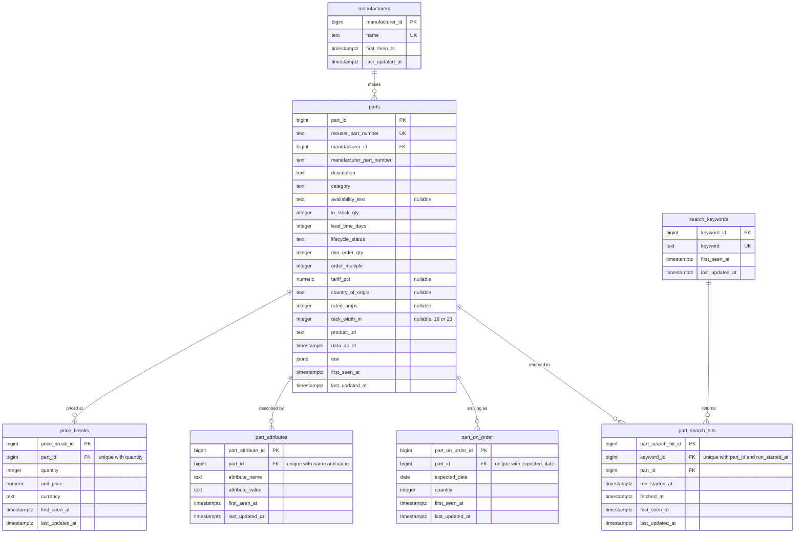

# Database schema

The database holds Mouser catalog data for datacenter parts. The tables are defined in [`db/schema.sql`](../db/schema.sql).

## Entity relationship diagram

## What one row means

| Table | One row is |
|---|---|
| `manufacturers` | One brand name, spelled the way Mouser spells it. Mouser provides no manufacturer ID. |
| `parts` | One product Mouser sells, holding the newest copy seen in the raw files. `data_as_of` says when that copy was fetched. |
| `price_breaks` | The unit price of one part when buying at least a given quantity. A part with no price breaks has no rows, so a missing price can't read as $0. |
| `part_attributes` | One name and value fact about a part, such as Packaging = Bulk. The value is part of the key because the same name repeats on some parts. |
| `part_on_order` | One incoming shipment of a part, with its quantity and expected arrival date. |
| `search_keywords` | One search term used against the Mouser API. |
| `part_search_hits` | One part returned for one keyword in one fetch run. This many-to-many table keeps the search history and shows noisy results. |

`first_seen_at` and `last_updated_at` record when a row reached this database. For when Mouser reported the data, use `parts.data_as_of` and `part_search_hits.run_started_at`.

## Design decision: amps and rack width as parsed columns

Mouser has no structured field for amperage or rack width. Across all 1,462 parts, `ProductAttributes` holds only `Standard Pack Qty` and `Packaging`, so these specs appear only in description text.

Claude recommended leaving them out of the columns this week and searching descriptions in the queries, because parsing free text can present a guess as a spec. I rejected that and added nullable `rated_amps` and `rack_width_in` columns, because the biggest mistakes in my baseline log were 16 A vs 20 A PDUs and 19 vs 23 inch racks. Those specs have to be queryable.

**The trade-off.** Parsed columns make the specs easy to filter, but they can only be as good as the descriptions. A pattern test showed how this goes wrong, so the rules are strict:

- `rated_amps` is filled only for power strips. Two different values on one part stay null (3 dual-rated parts), and values above 63 are ignored.
- `rack_width_in` is filled only for the two rack categories. A number described as a depth is rejected, which removed 5 false "23 inch" values.
- Null means the description doesn't clearly state the value. It never means "no."

The result is 63 of 257 power strips with an amp rating and 51 of 301 rack products with a width. The column is named `rated_amps` and not `circuit_amps` because descriptions usually give the unit's rating, often its input, and not the per-circuit breaker rating that caused my PDU mistake. The original text stays in `parts.raw`.

[ANTHONY: confirm this matches what you decided]
